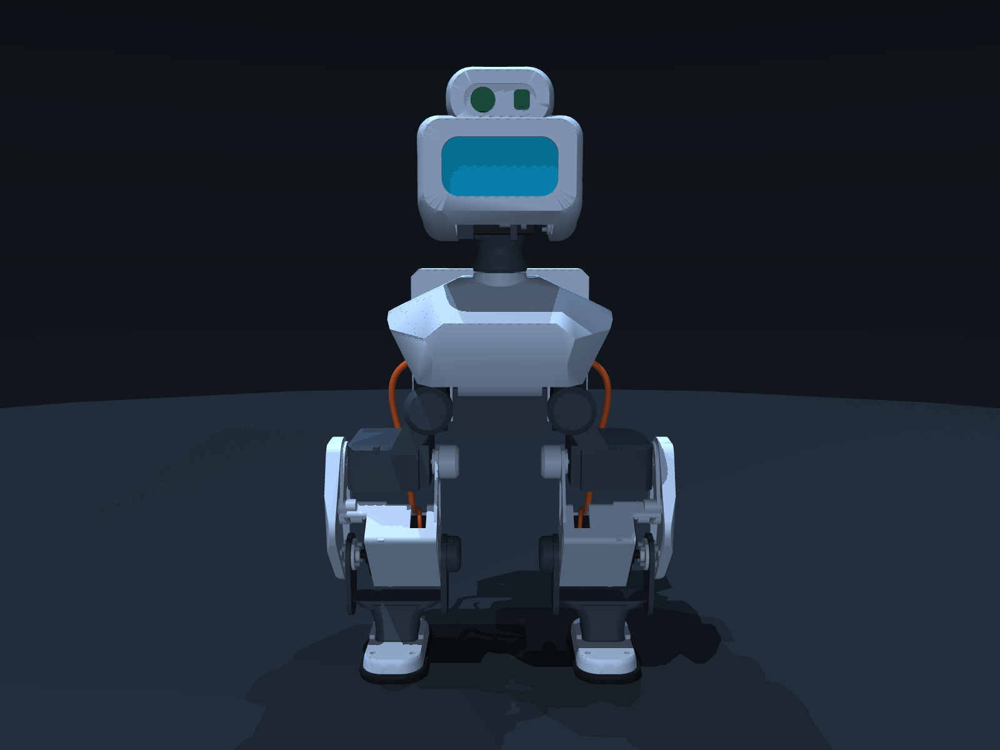

# CyberDuck V2

Đây là dự án học tập của sinh viên làm về robot hai chân 8 bậc tự do, từ khâu dựng cơ khí CAD, mô phỏng động lực học bằng MuJoCo, huấn luyện học tăng cường Sim-to-Real cho đến thử nghiệm trên mạch nhúng. Kho mã nguồn dùng một mô hình vật lý duy nhất là `src/robot/cyberduck_v2.xml` làm gốc cho mọi công đoạn.

Ba cấu hình phần cứng đích gồm Raspberry Pi 5, Raspberry Pi Zero 2 W và Dual ESP32-S3 chỉ tách nhau ở lớp đọc cảm biến, xuất xung servo và định dạng suy luận nằm trong `src/hardware/`. Cả ba nền tảng đều dùng chung một hình học robot và một hợp đồng điều khiển.

<p align="center">
  
  
</p>

## Các cấu hình phần cứng dự kiến

Phần mềm được tổ chức để cùng một mạng điều khiển có thể thử nghiệm trên nhiều bo mạch phổ thông dễ tiếp cận khi làm đồ án.

| Thông số | Raspberry Pi 5 | Dual ESP32-S3 | Raspberry Pi Zero 2 W |
| :--- | :--- | :--- | :--- |
| Thư mục mã nguồn | `src/hardware/rpi5/` | `src/hardware/dual_esp32s3/` | `src/hardware/pizero2w/` |
| Bộ xử lý | Broadcom BCM2712 Quad A76 2.4 GHz | 2 x ESP32-S3 Dual LX7 240 MHz | Broadcom BCM2710A1 Quad A53 1.0 GHz |
| Bộ nhớ | 4 GB hoặc 8 GB LPDDR4X | 2 x 512 KB SRAM và 8 MB PSRAM | 512 MB LPDDR2 |
| Hệ điều hành | Raspberry Pi OS 64-bit | FreeRTOS bare metal | Raspberry Pi OS Lite 64-bit |
| Điều khiển servo | Mạch PCA9685 qua I2C | 8 kênh LEDC PWM phần cứng | Mạch PCA9685 qua I2C |
| Định dạng policy 50 Hz | Float32 ONNX Runtime | C++ lượng tử hóa INT8 ESP-NN | Float32 ONNX Runtime |
| Bus liên mạch | Bus nội bộ hệ thống | UART2 921600 baud kèm CRC16 | Bus nội bộ hệ thống |
| Hướng thử nghiệm | Xử lý ảnh trực tiếp trên mạch | Chạy mạng gọn nhẹ tiêu thụ điện thấp | Chạy không màn hình gọn nhẹ |

## Cơ khí, động học và cảm biến

Robot dùng 8 động cơ servo MG996R, chia thành 2 bậc tự do ở cổ và 6 bậc tự do ở hai chân. Trong mô phỏng MuJoCo, mỗi khớp đặt ngưỡng mô-men `1.0 N.m`, tốc độ tối đa `6.0 rad/s`, hệ số PD `kp = 13.5 N.m/rad` và `kd = 0.9 N.m.s/rad`. Đây là các giới hạn giả định dùng để huấn luyện và cần đo kiểm lại trên lô servo mua thực tế trước khi lắp chạy ngoài đời.

Phần khung gá MG996R được lập trình tham số bằng `build123d` trong `src/cad/`. Trên phần mềm CAD, bộ lắp ráp hiện tại đã vượt qua các bài kiểm tra tự động gồm 0 giao cắt trên cả 3 cấu hình bo mạch, quét góc hành trình khớp, kiểm tra đường đi dây, tổng khối lượng cấu hình đầy đủ dưới mức `1.5 kg` và kiểm tra bề dày thành DfAM trên 28 chi tiết in 3D tại 512 điểm lấy mẫu. Tuy nhiên, robot vẫn chưa được in 3D hoàn chỉnh, lắp ốc và cân đo thực tế. Các yếu tố như lắp ghép ốc vít thật, hướng đặt in, độ rơ cơ khí và mô-men làm việc thực của servo vẫn cần đối chiếu lại lúc gia công.

Mô hình `src/robot/cyberduck_v2.xml` cùng hai tệp dẫn xuất `src/robot/cyberduck_v2_robot.xml` và `src/robot/cyberduck_v2.urdf` đã đồng bộ hình học và quán tính từ bộ CAD MG996R với giả định tỷ lệ điền đầy nhựa in FDM 60%. Gốc thân nằm ở độ cao `0.202 m`, chiều dài đùi `60 mm`, cẳng chân `54 mm`, khối tiếp xúc đế mỗi chân kích thước `82 x 46 x 12 mm` chạm phẳng mặt sàn tại `Z = 0.000 m`. Tổng khối lượng trong mô phỏng là `1.262 kg`, được tính từ quán tính từng khâu CAD và chưa qua cân đo trên robot lắp thật.

Hệ cảm biến trên mô hình gồm IMU ở thân, cảm biến tiếp xúc hai bàn chân, cảm biến góc và vận tốc cho 8 khớp, camera gắn đầu và 1 cảm biến đo khoảng cách laser `head_tof` đặt ở trán với tầm đo `2.0 m`. Trên phần cứng, phần mặt dự kiến dùng màn hình OLED SSD1309 độ phân giải `128x64` giao tiếp SPI để hiển thị biểu cảm mắt.

| Tên khớp | Trục | Giới hạn rad | Giới hạn độ | Mô-men mô phỏng | Tốc độ tối đa |
| :--- | :---: | :---: | :---: | :---: | :---: |
| `head_yaw` | Z | -1.57 đến +1.57 | -90 đến +90 | 1.0 N.m | 6.0 rad/s |
| `head_pitch` | Y | -0.52 đến +0.78 | -30 đến +45 | 1.0 N.m | 6.0 rad/s |
| `left_hip_roll` | X | -0.44 đến +0.44 | -25 đến +25 | 1.0 N.m | 6.0 rad/s |
| `left_hip_pitch` | Y | -0.87 đến +0.87 | -50 đến +50 | 1.0 N.m | 6.0 rad/s |
| `left_knee_pitch` | Y | 0.00 đến +1.48 | 0 đến +85 | 1.0 N.m | 6.0 rad/s |
| `right_hip_roll` | X | -0.44 đến +0.44 | -25 đến +25 | 1.0 N.m | 6.0 rad/s |
| `right_hip_pitch` | Y | -0.87 đến +0.87 | -50 đến +50 | 1.0 N.m | 6.0 rad/s |
| `right_knee_pitch` | Y | 0.00 đến +1.48 | 0 đến +85 | 1.0 N.m | 6.0 rad/s |

## Hợp đồng điều khiển và các mô-đun phần mềm

Vòng điều khiển chạy ở tần số `50 Hz`, ứng với chu kỳ điều khiển `0.02 s` trên bước tích phân vật lý `0.002 s`. Mạng Actor triển khai là MLP kiến trúc `37 -> 256 -> 256 -> 8` dùng hàm kích hoạt `ELU`. Vectơ quan sát `37` chiều gồm vận tốc góc thân 3 chiều, vectơ trọng lực chiếu 3 chiều, lệnh vận tốc `vx`, `vy`, `wz` 3 chiều, vị trí 8 khớp, vận tốc 8 khớp, hành động bước trước 8 chiều, tiếp xúc hai bàn chân 2 chiều và cặp pha nhịp bước `sin`, `cos` 2 chiều. Khi huấn luyện Asymmetric PPO, mạng Critic nhận thêm 11 chiều trạng thái đặc quyền thành đầu vào `48` chiều để ước lượng hàm giá trị ổn định hơn mà không đưa các tín hiệu khó đo vào mạng chạy trên mạch.

Mỗi checkpoint và tệp ONNX mới đều lưu tên mô hình `cyberduck_v2.xml` cùng trường `observation_schema` phiên bản `2`. Đồng hồ pha chu kỳ `0.8 s` đặt về `0` lúc bắt đầu tập mới và tăng sau mỗi hành động ngay cả khi lệnh vận tốc bằng `0`. Các lớp nạp trên Raspberry Pi, trình xem 3D và công cụ xuất đều kiểm tra chặt metadata này, từ chối tệp cũ hoặc sai lược đồ và không suy đoán theo kích thước tensor.

```json
{"version":2,"obs_dim":37,"embed_phase_clock":true,"period":0.8,"control_dt":0.02,"reset":"episode_steps_zero","advance":"after_action","zero_command":"advance"}
```

Bộ mô phỏng song song đặt tại `src/sim/env/run_parallel_sim.py` và cấu hình phần thưởng nằm ở `src/sim/env/env_config.py`. Chuỗi huấn luyện trong `src/tools/train/` gồm `pretrain_bc.py` cho học bắt chước có đối xứng và DAgger, `train_ppo.py` cho Asymmetric PPO kèm chiếu gương trái phải, trễ hành động, sụt áp pin, ngẫu nhiên hóa động lực học dạng Markov và nhiễu cảm biến riêng cho Actor, cùng `train_sac.py` thử nghiệm FastSAC dùng hàm `ELU`.

Ngoài phần học tăng cường, kho mã nguồn còn tách riêng các mô-đun hành vi, nhận thức và bảo vệ an toàn. Trong đó, `src/sim/behaviors/advanced_gaits.py` cài các dáng đi hở vòng để kiểm tra khớp như đi lắc kiểu vịt, xoay tại chỗ, lắc đầu và máy trạng thái tự đứng dậy 3 pha không có ngoại lực trợ giúp. Với phần cảm biến trán, `src/sim/behaviors/active_head_scanner.py` xoay cổ cho `head_tof` quét ngang, lọc bỏ các tia cúi xuống sàn và dựng bộ nhớ 5 tia ảo có thời hạn `2.0 s` cấp cho bộ dẫn đường `LidarWaypointPlanner`. Phần bám vật thể theo màu HSV qua khớp cổ nằm ở `src/sim/perception/vision_tracker.py`, còn `src/hardware/oled_eyes.py` vẽ 5 biểu cảm mắt `128x64` xoay 180 độ cho `SSD1309Display`. Ở tầng phần cứng, `src/hardware/rpi_infer_core.py` cùng firmware trong `src/hardware/dual_esp32s3/deployment/` áp dụng cơ chế dừng an toàn khi lỗi I2C, IMU hoặc cảm biến ToF, ngắt xung PWM `PCA9685` lúc kích hoạt bảo vệ ngã `limp_fall`, giữ nguyên tư thế nếu mạng xuất `NaN` hoặc `Inf` và đưa lệnh vận tốc về `0` khi quá thời gian chờ.

## Cài đặt và sử dụng với duck.py

Dự án cần Python 3.10 trở lên để chạy mô phỏng và kiểm thử. Nếu muốn chạy các bài kiểm tra biên dịch C++ cho ESP32-S3, hãy cài sẵn `g++` trên `PATH`. Phần CAD tham số dùng `build123d` chạy trong môi trường ảo riêng `.venv_cad` để tránh xung đột thư viện với môi trường huấn luyện.

```bash
python -m pip install pytest numpy mujoco torch onnx onnxruntime opencv-python
```

Các tác vụ chính từ xem trạng thái, kiểm tra vật lý, mở trình xem tương tác `src/tools/robot/interactive_viewer.py`, huấn luyện PPO cho tới xuất mô hình đều gọi qua `duck.py` tại thư mục gốc.

```bash
# Xem tổng quan kiến trúc mạng, checkpoint và tệp triển khai
python duck.py status

# Kiểm tra vật lý MJCF/URDF qua verify_model.py và chạy toàn bộ pytest
python duck.py verify

# Mở trình xem 3D tương tác với mô hình CyberDuck V2
python duck.py view

# Chạy thử dáng đi lắc, xoay tại chỗ hoặc bám màu qua camera đầu
python duck.py view --gait waddle
python duck.py view --gait spot_turn
python duck.py view --track --target-color yellow

# Chạy thử 1 vòng lặp huấn luyện để kiểm tra đường ống
python duck.py train --dry-run

# Huấn luyện PPO cho CyberDuck V2 kèm các tùy chọn Sim-to-Real
python duck.py train --target rpi5 --envs 256 --iterations 500 --curriculum-smoothness --max-action-delay 2

# Xuất policy đã huấn luyện sang ONNX cho Raspberry Pi và INT8 C header cho ESP32-S3
python duck.py export --target rpi5
python duck.py export --target pizero2w
python duck.py export --target esp32
python duck.py export --target all
```

Mọi cấu hình huấn luyện đều lưu chung theo quy ước tên `cyberduck_v2_ppo.pt`, `cyberduck_v2_latest.pt` và `cyberduck_v2_best.pt` trong `models/checkpoints/`. Các checkpoint cũ chưa có metadata schema đã được đưa vào `models/checkpoints/legacy_pre_schema/`. Tệp `models/cyberduck_v2_policy.onnx` cùng hai tệp header trong `src/hardware/dual_esp32s3/deployment/` hiện mới là bản xuất mẫu 37 chiều để kiểm thử đường ống triển khai, chưa qua huấn luyện đầy đủ trên GPU.

Để chạy từng nhóm kiểm thử độc lập trên bản sao mới tải về:

```bash
python src/tools/robot/verify_model.py --steps 1000
python -m pytest tests/robot tests/sim tests/hardware -q -p no:cacheprovider
.\.venv_cad\Scripts\python.exe -m pytest tests/cad -q -p no:cacheprovider
.\.venv_cad\Scripts\python.exe -m pytest tests/cad --run-slow -q -p no:cacheprovider
```

## Cấu trúc thư mục

```text
.
├── duck.py                     # Giao diện dòng lệnh trung tâm
├── README.md                   # Tài liệu tổng quan dự án
├── LICENSE                     # Giấy phép MIT
├── .gitignore                  # Bỏ qua artifacts/, docs/plans/, docs/his.md
├── src/
│   ├── robot/                  # cyberduck_v2.xml, cyberduck_v2_robot.xml, cyberduck_v2.urdf, robot_spec.py, meshes/, media/
│   ├── cad/                    # Nguồn CAD tham số build123d chạy với .venv_cad
│   ├── sim/                    # env/, behaviors/, perception/
│   ├── hardware/               # rpi_infer_core.py, oled_eyes.py, rpi5/, pizero2w/, dual_esp32s3/
│   └── tools/                  # train/, robot/, cad/, viewer_3d.html
├── tests/                      # Bộ kiểm thử chia theo robot/, sim/, hardware/, cad/
├── models/                     # Policy ONNX và thư mục checkpoints/
├── artifacts/                  # Đầu ra sinh tự động từ CAD, không theo dõi trên Git
└── docs/                       # Tài liệu đặc tả, báo cáo audit, hướng dẫn Isaac và kho lưu trữ V1
```

## Chuyển mô hình sang Isaac Lab

Quy trình đưa robot sang Isaac Sim hoặc Isaac Lab được ghi cụ thể trong [docs/isaac_v2_migration.md](docs/isaac_v2_migration.md). Kho mã nguồn đã tạo sẵn `src/robot/cyberduck_v2_robot.xml` và `src/robot/cyberduck_v2.urdf` đặt cạnh thư mục `src/robot/meshes/` để nhập thử articulation và kiểm tra quán tính. Máy phát triển hiện tại mới cài PyTorch bản CPU, chưa cài Isaac và chưa có tệp USD hay số liệu đối chiếu solver thực tế.

## Trạng thái hiện tại

- Đang dừng ở đâu: nhánh `main` tại commit mã nguồn `5317b516` và cập nhật bàn giao `763f4163`, đã hoàn tất đồng bộ CAD MG996R sang MJCF và URDF với khối lượng mô phỏng `1.262 kg`, cao độ thân `0.202 m` và hợp đồng điều khiển `37` quan sát actor, `48` quan sát critic ở `50 Hz`; chưa chạy huấn luyện dài hạn trên GPU và chưa gắn Git tag điểm neo trọng số V2.
- Đã hoàn thành: sửa các lỗi thuật toán RL và cơ chế an toàn fail-closed trên Raspberry Pi và Dual ESP32-S3, vượt qua kiểm tra lắp ráp 0 giao cắt cùng bề dày thành DfAM cho 28 chi tiết in 3D trên CAD, thêm `ActiveHeadScanner` và `OLED SSD1309`, chuẩn hóa toàn bộ chuỗi mô phỏng, huấn luyện và xuất tệp sang cảm biến đơn trán `head_tof` và vectơ `37` chiều.
- Kết quả kiểm thử: `628 passed` trên `tests/robot`, `tests/sim`, `tests/hardware`; `193 passed` trên `tests/cad --run-slow`; `python duck.py train --dry-run` và `python duck.py verify` đều thoát `0`.
- Bước tiếp theo: huấn luyện đầy đủ trên máy có GPU theo chuỗi `pretrain_bc.py`, Asymmetric PPO và ELU FastSAC cho hợp đồng `37` chiều, sau đó in lắp phần cứng MG996R để cân đo, hiệu chỉnh và chốt checkpoint V2 chính thức.

## Giấy phép

Dự án phát hành theo [MIT License](LICENSE). Bản quyền 2026 PhelanDev.
