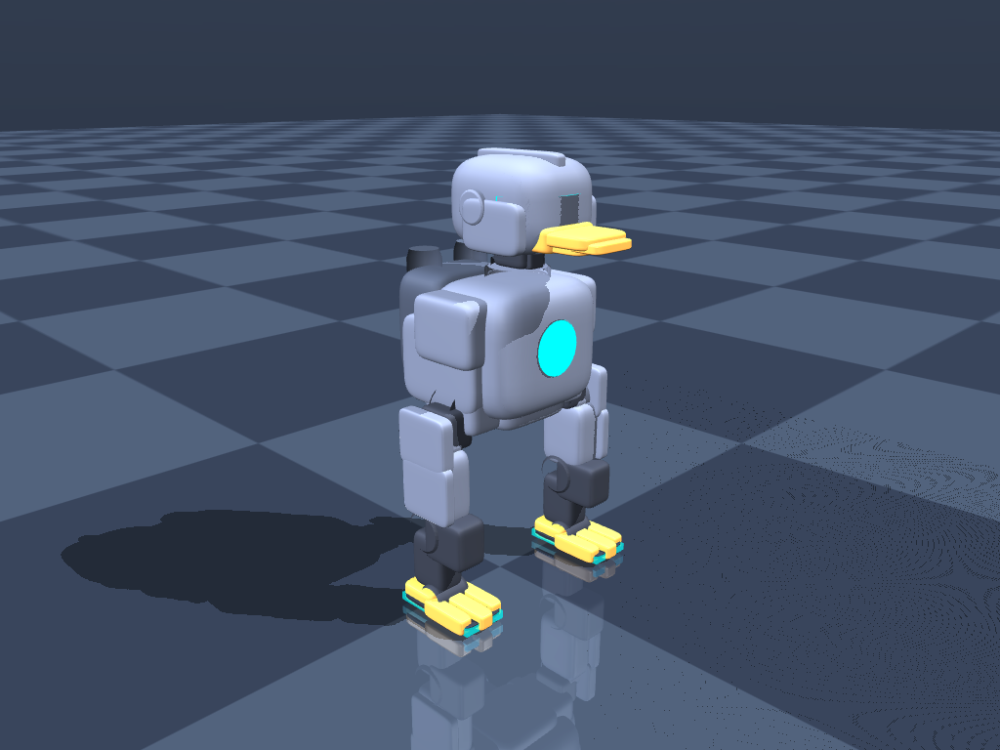

# CyberDuck V2 Pro

An 8-DOF bipedal robot for simulation training and sim-to-real research. CyberDuck V2 is the sole robot model used by training, simulation, verification, and policy export. Raspberry Pi 5, Raspberry Pi Zero 2 W, and Dual ESP32-S3 are deployment profiles for the same robot and policy contract.

[](LICENSE)
[](https://www.python.org/)
[](https://mujoco.org/)

<p align="center">
  
  
</p>

---

## 1. Robot And Deployment Profiles

`src/robot/cyberduck_v2.xml` is the canonical physical model. Platform-specific code under `src/hardware/` selects hardware I/O and inference format; it must not define a different robot geometry or training checkpoint.

| Parameter | Raspberry Pi 5 | Dual ESP32-S3 | Raspberry Pi Zero 2 W |
| :--- | :--- | :--- | :--- |
| **Hardware path** | `src/hardware/rpi5/` | `src/hardware/dual_esp32s3/` | `src/hardware/pizero2w/` |
| **Robot model** | CyberDuck V2 | CyberDuck V2 | CyberDuck V2 |
| **Main compute** | Broadcom BCM2712 Quad A76 @ 2.4 GHz | 2× ESP32-S3 Dual LX7 @ 240 MHz | Broadcom BCM2710A1 Quad A53 @ 1.0 GHz |
| **Memory** | 4 GB / 8 GB LPDDR4X | 2× 512 KB SRAM + 8 MB PSRAM | 512 MB LPDDR2 |
| **Operating system** | Raspberry Pi OS 64-bit | FreeRTOS (bare metal) | Raspberry Pi OS Lite 64-bit |
| **Servo interface** | PCA9685 I2C PWM driver | 8-channel hardware LEDC PWM | PCA9685 I2C PWM driver |
| **Policy runtime** | Float32 ONNX Runtime (50 Hz) | Quantized INT8 ESP-NN C++ (50 Hz) | Float32 ONNX Runtime (50 Hz) |
| **Inter-chip bus** | Internal system bus | High-speed UART2 @ 921,600 baud with CRC16 | Internal system bus |
| **Primary focus** | Onboard vision & dense models | Low-power embedded execution | Lightweight headless Linux runner |

---

## 2. CyberDuck V2 Pro: Athletic Redesign

CyberDuck V2 Pro redesigns the bipedal chassis with high-definition bionic styling and improved mechanical balance:

- **17 Precision CAD Parts**: High-density STL meshes (>125,000 triangles total) comprising an aero helmet, cyan visor, metallic beak, filleted neck collar, chest plate, rear thruster pack, leg linkages, and 3-claw athletic feet.
- **Universal Gimbal Neck**: Dual-DOF universal joint matching hip gimbal mechanics. Head is lowered by 8 mm into an aggressive athletic stance, with a filleted collar eliminating visual gaps.
- **Athletic Soles**: The simulation support collider is $50\text{ mm} \times 26\text{ mm} \times 8\text{ mm}$, aligned to the tread footprint and the ground plane at $Z = 0.000\text{ m}$.
- **CAD Exports**: Full 3D assembly in `src/robot/cad/cyberduck_v2_assembly.obj` with MTL PBR materials, accompanied by printable parts in `src/robot/cad/cyberduck_v2_stl_parts.zip`.
- **Integrated Simulation Sensors**: Base IMU, dual foot contact, eight joint states, five forward range rays, and a head camera. The actor observation contract is 42 dimensions; hardware sensor availability must be verified separately before deployment.

---

## 3. Kinematics & Servo Specifications

**Hardware target:** 8 metal-gear MG996R servos. The MJCF uses a nominal 1.0 N·m torque limit and 6.0 rad/s speed limit; these are simulation limits, not measured performance of the selected servos.

**Mechanical status:** The current skeleton CAD generator still contains a micro-servo-sized concept. It is not a verified MG996R mounting design; the brackets and leg links need a mechanical redesign and fit check before fabrication. The visual armor CAD is separate from this actuator mounting issue.

### Chibi Squat Geometry

The canonical V2 MJCF currently specifies:

- Thigh link length: 44 mm; shin link length: 36 mm.
- Base link origin: $Z = 0.128\text{ m}$.
- Model mass: 811 g, from the explicit link inertials in the canonical MJCF. This is a simulation-model value, not a measured assembled robot mass.
- Servo model limits: $1.0\text{ N}\cdot\text{m}$ torque and $6.0\text{ rad/s}$; identify actual MG996R variants and validate usable torque, speed, and mounting fit before treating these as hardware measurements.

### Joint Limits

| Joint Name | Axis | Limits (rad) | Limits (deg) | Rated Torque | Max Speed |
| :--- | :---: | :---: | :---: | :---: | :---: |
| `head_yaw` | $Z$ | $[-1.57, +1.57]$ | $\pm 90^\circ$ | 1.0 N·m | 6.0 rad/s |
| `head_pitch` | $Y$ | $[-0.52, +0.78]$ | $-30^\circ \to +45^\circ$ | 1.0 N·m | 6.0 rad/s |
| `left_hip_roll` | $X$ | $[-0.44, +0.44]$ | $\pm 25^\circ$ | 1.0 N·m | 6.0 rad/s |
| `left_hip_pitch` | $Y$ | $[-0.87, +0.87]$ | $\pm 50^\circ$ | 1.0 N·m | 6.0 rad/s |
| `left_knee_pitch` | $Y$ | $[0.00, +1.48]$ | $0^\circ \to +85^\circ$ | 1.0 N·m | 6.0 rad/s |
| `right_hip_roll` | $X$ | $[-0.44, +0.44]$ | $\pm 25^\circ$ | 1.0 N·m | 6.0 rad/s |
| `right_hip_pitch` | $Y$ | $[-0.87, +0.87]$ | $\pm 50^\circ$ | 1.0 N·m | 6.0 rad/s |
| `right_knee_pitch` | $Y$ | $[0.00, +1.48]$ | $0^\circ \to +85^\circ$ | 1.0 N·m | 6.0 rad/s |

---

## 4. Behavioral Engine & AI Vision

### Kinematic Gaits and Reflexes

Located in `src/sim/behaviors/advanced_gaits.py`:

- **Waddling Gait**: Open-loop V2 preview with pelvic roll sway (0.08 rad) and double-frequency head nodding. These demos do not provide feedback balance for hardware or uneven terrain.
- **Spot Turn**: 360-degree rotation in place ($v_x = 0, \omega_z \ne 0$) without forward translation.
- **Head Dance**: Expressive Lissajous head gestures while maintaining a stable stance.
- **Fall Recovery**: 3-phase finite state machine (`ORIENT_PRONE` $\to$ `CROUCH_TO_SIT` $\to$ `PUSH_TO_STAND`) with angular rate limits ($|\Delta q| \le 0.10\text{ rad/step}$) to protect servo gears.

### AI Vision and Visual Servoing

Located in `src/sim/perception/vision_tracker.py`:

- **Color Blob Tracking**: High-throughput HSV segmentation for yellow targets and red objects running at 30+ FPS.
- **Visual Servoing**: Closed-loop proportional tracking for `head_yaw` and `head_pitch` with an anti-jitter deadband (0.06) and slew rate limiting.
- **Embedded C++ Loop**: Sub-sampled RGB565 scan routine in `src/hardware/dual_esp32s3/deployment/mcu1_vision_audio_s3/mcu1_main.ino` streaming 8-byte binary UART servo packets to MCU 2.

---

## 5. Unified CLI: duck.py

The root `duck.py` CLI provides a single command surface across development workflows:

```bash
# Check system status, checkpoints, and hardware targets
python duck.py status

# Verify the canonical V2 model and generated URDF
python duck.py verify

# Launch the canonical CyberDuck V2 simulation
python duck.py view

# Run waddling gait demonstration
python duck.py view --gait waddle

# Run spot turn demonstration
python duck.py view --gait spot_turn

# Enable visual servoing with onboard head camera
python duck.py view --track --target-color yellow

# Combine CyberDuck V2 with waddling gait and vision tracking
python duck.py view --v2 --gait waddle --track

# Train one V2 policy (target selects deployment profile only)
python duck.py train --target rpi5 --envs 256 --iterations 500
python duck.py train --target pizero2w --envs 256 --iterations 500
python duck.py train --target esp32 --envs 256 --iterations 500

# Export trained policy
python duck.py export --target rpi5
python duck.py export --target pizero2w
python duck.py export --target esp32
```

All training profiles use the `cyberduck_v2_{ppo,latest,best}.pt` checkpoint namespace. A platform target selects deployment packaging, not model identity. `export --target all` packages the same V2 policy for each runtime.

The pre-existing V2 checkpoints lack model identity and observation schema, so the active consumers reject them. Train a fresh policy into a new output path after the geometry is finalized. The shipped ESP headers also require regeneration from a valid V2 policy before firmware compilation.
Resume yêu cầu cùng model, terrain, observation schema và kích thước tensor;
Checkpoints without the V2 identity or observation schema are rejected; do not transfer weights from a different robot model.

Checkpoint và ONNX mới mang `observation_schema` gồm clock, period, control timestep
và quy tắc reset. Clock tăng sau mỗi action, cả khi command bằng zero.
Runtime Pi rejects policies without the V2 schema. Do not infer clock rules from tensor size. JSON schema for the V2 policy clock at 50 Hz:

```json
{"version":1,"obs_dim":42,"embed_phase_clock":true,"period":0.8,"control_dt":0.02,"reset":"episode_steps_zero","advance":"after_action","zero_command":"advance"}
```

Tests công khai nằm trong `tests/`. Trên clean checkout, cài các dependency Python
và đặt `g++` trên PATH để chạy kiểm tra header/firmware C++:

```bash
python -m pip install pytest numpy mujoco torch onnx onnxruntime opencv-python
python -m pytest tests/robot tests/sim tests/hardware -q -p no:cacheprovider
.\.venv_cad\Scripts\python.exe -m pytest tests/cad -q -p no:cacheprovider
python duck.py verify
```

`verify` chạy kiểm tra vật lý cùng test suite, không yêu cầu train dài hoặc robot thật.
Tests tạo checkpoint/ONNX/header trong thư mục tạm. Browser dashboard được giữ nguyên
và đưa vào Git vì test CLI hiện kiểm contract của file này.

---

## 6. Repository Layout

```text
cyberduck-v2/
├── duck.py                                   # Unified operations CLI
├── README.md                                 # Technical documentation
├── LICENSE                                   # MIT License
├── .gitignore                                # Git ignore configuration (incl. artifacts/, docs/his.md)
├── src/                                      # Source modules & canonical V2 robot assets
│   ├── robot/                                # cyberduck_v2.xml, cyberduck_v2.urdf, robot_spec.py, meshes/, cad/, media/
│   ├── cad/                                  # Parametric build123d CAD sources (.venv_cad)
│   ├── sim/                                  # env/ (env_config.py, run_parallel_sim.py), behaviors/, perception/
│   ├── hardware/                             # rpi_infer_core.py, rpi5/, dual_esp32s3/, pizero2w/
│   └── tools/                                # train/, robot/ (verify_model.py, interactive_viewer.py, export_policy.py), cad/, viewer_3d.html
├── tests/                                    # Domain-grouped pytest suite (robot/, sim/, hardware/, cad/)
├── models/                                   # V2 policy and checkpoint artifacts (.onnx & checkpoints/*.pt)
├── artifacts/                                # Gitignored generated CAD drafts, reviews & reports
└── docs/                                     # Specs, migration guide, audit, plans/, archive/v1/ & his.md
```

---

## Đưa V2 vào Isaac

Xem [hướng dẫn chuyển V2 sang Isaac](docs/isaac_v2_migration.md) để chọn asset nhập, giữ hợp đồng điều khiển và kiểm tra solver trước training. Đã có robot-only MJCF và URDF dẫn xuất; chưa có USD hoặc kết quả chạy Isaac. Môi trường Python hiện tại chưa cài Isaac và Torch đang là bản CPU.

Mesh và articulation đủ để bắt đầu kiểm tra import. Khung gá MG996R, inertial đo từ robot thật và cảm biến deployment cần hoàn thiện trước khi coi mô hình đạt yêu cầu sim-to-real.

## 7. Trạng Thái Hiện Tại & Điểm Neo Khôi Phục

- **Đang dừng ở đâu (2026-11-18):** Đang triển khai CAD MG996R trên `wip/fix-project-audit` tại `6ac4c124`, chưa commit/tag mới; **chưa qua nghiệm thu Phase 1, chưa sẵn sàng chế tạo**. Canonical V2 vẫn 0.811 kg / 128–44–36 mm, contract 42 obs / 8 actions / 50 Hz.
- **Đã làm:** Tạo `.venv_cad`, 77 part B-rep, 32 fit reference + 9 STEP nguồn có hash; sửa và kiểm tra riêng càng/vòng bi, chân phải, pin/nguồn và ba module điện tử; xuất 180 STEP/STL/3MF/BOM artifact nháp tại `duck_v2/cad/draft/` (nay chuyển về `artifacts/cad/draft/`); đã xóa ảnh `microduck_concept_render.jpg` khỏi kho lưu trữ V1 (`docs/archive/v1/`).
- **Kiểm chứng:** 198 CAD tests đạt; `python duck.py verify` exit 0 với `579 passed, 7 skipped, 38 warnings` (7 module CAD chạy riêng). Assembly đầy đủ còn giao cắt và quá ngân sách mass; `release_ready=false`. Xem [báo cáo thực thi](docs/plans/261118-1705-cyberduck-v2-mg996r-3d-rebuild/execution.md).
- **Bước tiếp theo:** Sửa giao cắt toàn cụm/cổ rỗng, mating ốc và 22 part có mẫu thành mỏng; giảm mass có cơ sở, nghiệm thu sweep + DfAM rồi mới đồng bộ CAD sang MJCF/URDF/mesh/biến thể và torque smoke; chưa train hoặc tạo neo weights V2 mới.

### Rà soát thuật toán ngày 2026-11-19

- **Đang dừng ở đâu:** Audit trên `wip/fix-project-audit`, HEAD `6ac4c124`, gồm working tree; chưa sửa thuật toán hoặc tạo checkpoint/tag V2 mới.
- **Đã kiểm tra:** Xác nhận 13 vấn đề trong cảm biến/deployment, planner, recovery, action/observation, randomization, benchmark, vision, exporter, mass dây CAD và test collection; xem [báo cáo audit](docs/project_algorithm_audit_2026-11-19.md).
- **Kiểm chứng:** Physics verifier đạt; full pytest dừng do import `build123d` trước `importorskip`; bỏ riêng module đó đạt `579 passed, 8 skipped, 38 warnings`. Kiểm live 78 artifact nháp không sai hash nhưng `source_current=false`; báo cáo CAD cần tái tạo từ snapshot nguồn thống nhất.
- **Bước tiếp theo:** Ưu tiên lỗi cảm biến và dừng chuyển động, sửa phép đo benchmark/recovery cùng các hợp đồng điều khiển; chốt nguồn CAD và kiểm chứng lại trước huấn luyện dài hoặc triển khai robot thật.

### Quy hoạch lại kiến trúc thư mục ngày 2026-11-19

- **Đang dừng ở đâu:** Nhánh `wip/repo-reorg` trên cấu trúc mặt tiền sạch `src/{robot,cad,sim,hardware,tools}`, `tests/{robot,sim,hardware,cad}/`, `models/`, `docs/{specs,plans,archive/v1,his.md}`, `artifacts/` (gitignored); chưa tạo tag neo weights V2 mới.
- **Đã làm:** Chuyển 5 trụ cột vào `src/`, dời `viewer_3d.html` sang `src/tools/viewer_3d.html`, dời `his.md`, `plans/`, `archive/v1/` vào `docs/`, xóa phần trùng trong `docs/superpowers/`, ẩn thư mục cache/AI trên Windows Explorer, sửa thứ tự `importorskip('build123d')`, cập nhật contract test `tests/robot/test_repo_layout_contract.py` và toàn bộ đường dẫn trong `duck.py`, `src/`, `tests/`, tài liệu.
- **Kiểm chứng:** `pytest tests/robot tests/sim tests/hardware`, `.venv_cad` `pytest tests/cad`, `python duck.py verify` và `python src/tools/robot/verify_model.py --steps 1000` đều pass 100%, `git ls-files artifacts` rỗng.
- **Bước tiếp theo:** Xử lý các hạng mục F01–F04 trong báo cáo audit `docs/project_algorithm_audit_2026-11-19.md`, hoàn thiện cơ khí MG996R trong `src/cad/` và nhập `src/robot/cyberduck_v2.urdf` sang Isaac Lab trước khi huấn luyện lại policy V2 mang metadata đầy đủ.

---

## 8. License

Distributed under the [MIT License](LICENSE). Copyright (c) 2026 PhelanDev.
