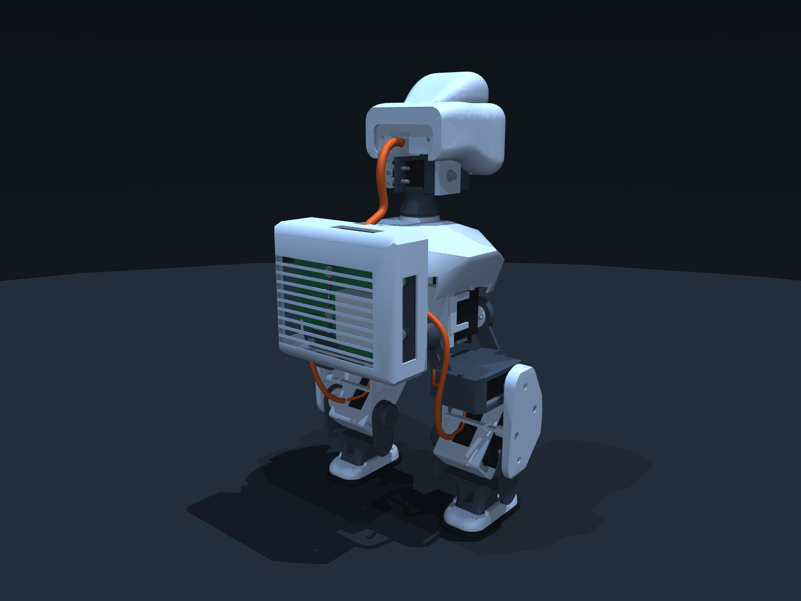
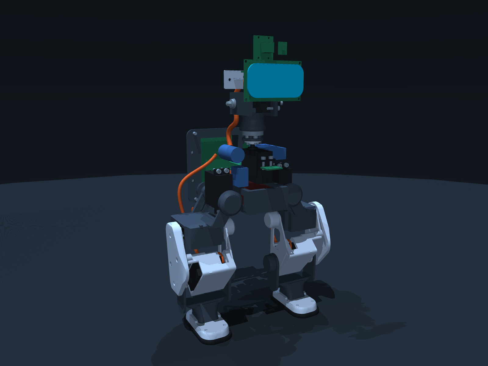

# CyberDuck V2

CyberDuck V2 is a student learning project built to practice the full robotics workflow on an 8-DOF bipedal robot, from parametric CAD and MuJoCo simulation to sim-to-real reinforcement learning and embedded deployment. Every script in this repository targets one canonical physical model at `src/robot/cyberduck_v2.xml`.

Deployment code under `src/hardware/` covers three board profiles for Raspberry Pi 5, Raspberry Pi Zero 2 W, and Dual ESP32-S3. Those profiles only switch sensor drivers, PWM output, and inference format; all three use the same robot geometry and policy contract.

<p align="center">
  
  
</p>

## Hardware deployment targets

The runtime layer targets common single-board computers and microcontrollers that fit a student hardware budget.

| Parameter | Raspberry Pi 5 | Dual ESP32-S3 | Raspberry Pi Zero 2 W |
| :--- | :--- | :--- | :--- |
| Source directory | `src/hardware/rpi5/` | `src/hardware/dual_esp32s3/` | `src/hardware/pizero2w/` |
| Processor | Broadcom BCM2712 Quad A76 at 2.4 GHz | 2 x ESP32-S3 Dual LX7 at 240 MHz | Broadcom BCM2710A1 Quad A53 at 1.0 GHz |
| Memory | 4 GB or 8 GB LPDDR4X | 2 x 512 KB SRAM and 8 MB PSRAM | 512 MB LPDDR2 |
| Operating system | Raspberry Pi OS 64-bit | FreeRTOS bare metal | Raspberry Pi OS Lite 64-bit |
| Servo interface | PCA9685 over I2C | 8-channel hardware LEDC PWM | PCA9685 over I2C |
| Policy runtime at 50 Hz | Float32 ONNX Runtime | Quantized INT8 ESP-NN C++ | Float32 ONNX Runtime |
| Inter-board bus | Internal system bus | UART2 at 921600 baud with CRC16 | Internal system bus |
| Intended use | Onboard vision and dense models | Low-power embedded inference | Lightweight headless Linux runner |

## Mechanical design, kinematics, and sensors

The robot uses eight MG996R servos, split into two neck joints and six leg joints. Inside MuJoCo, each joint has a `1.0 N.m` torque limit, a `6.0 rad/s` speed limit, and PD gains of `kp = 13.5 N.m/rad` and `kd = 0.9 N.m.s/rad`. Those values are simulation assumptions and still need bench measurements on real servos before physical trials.

The MG996R frame is modeled parametrically with `build123d` in `src/cad/`. Automated CAD checks pass with zero assembly interferences across all three board variants, full joint motion sweeps, wire routing lengths, a full-configuration mass budget below `1.5 kg`, and DfAM wall-thickness checks across 28 printable parts at 512 samples per part. No physical robot has been printed, assembled, or weighed yet, so fastener fit, print orientation, mechanical backlash, and usable servo torque remain to be verified on real hardware.

Geometry and link inertials in `src/robot/cyberduck_v2.xml`, `src/robot/cyberduck_v2_robot.xml`, and `src/robot/cyberduck_v2.urdf` are synced directly from the MG996R CAD model assuming 60% FDM infill for printed parts. Base height is `0.202 m`, thigh length is `60 mm`, shin length is `54 mm`, and each foot sole collider measures `82 x 46 x 12 mm` resting flat at `Z = 0.000 m`. Total simulated mass is `1.262 kg`, calculated from CAD link inertials and not yet weighed on an assembled robot.

Simulation sensors include a trunk IMU, dual foot contact sensors, position and velocity sensors for all eight joints, a head camera, and a single brow-mounted `head_tof` rangefinder with a `2.0 m` cutoff. Hardware builds also place a `128x64` SPI SSD1309 OLED screen behind the visor for eye expressions.

<p align="center">
  
  
</p>

| Joint name | Axis | Limits rad | Limits deg | Sim torque | Max speed |
| :--- | :---: | :---: | :---: | :---: | :---: |
| `head_yaw` | Z | -1.57 to +1.57 | -90 to +90 | 1.0 N.m | 6.0 rad/s |
| `head_pitch` | Y | -0.52 to +0.78 | -30 to +45 | 1.0 N.m | 6.0 rad/s |
| `left_hip_roll` | X | -0.44 to +0.44 | -25 to +25 | 1.0 N.m | 6.0 rad/s |
| `left_hip_pitch` | Y | -0.87 to +0.87 | -50 to +50 | 1.0 N.m | 6.0 rad/s |
| `left_knee_pitch` | Y | 0.00 to +1.48 | 0 to +85 | 1.0 N.m | 6.0 rad/s |
| `right_hip_roll` | X | -0.44 to +0.44 | -25 to +25 | 1.0 N.m | 6.0 rad/s |
| `right_hip_pitch` | Y | -0.87 to +0.87 | -50 to +50 | 1.0 N.m | 6.0 rad/s |
| `right_knee_pitch` | Y | 0.00 to +1.48 | 0 to +85 | 1.0 N.m | 6.0 rad/s |

## Control contract and software modules

The control loop runs at `50 Hz`, with a `0.02 s` control timestep and a `0.002 s` physics step. The deployed actor is an ELU MLP with shape `37 -> 256 -> 256 -> 8`. Its 37-element observation vector packs 3 base angular velocity readings, 3 projected gravity components, 3 velocity commands `vx`, `vy`, `wz`, 8 joint positions, 8 joint velocities, 8 previous actions, 2 foot contact flags, and 2 gait phase terms `sin` and `cos`. During Asymmetric PPO training, the critic takes 11 additional privileged state terms for a `48`-element input so value estimates stay stable while the deployed actor only uses signals available on hardware.

Every new checkpoint and ONNX export stores the `cyberduck_v2.xml` model identity and `observation_schema` version `2`. The `0.8 s` gait clock resets to `0` at episode start and advances after every action even when the velocity command is zero. Loaders on Raspberry Pi, the 3D viewer, and the export CLI validate this metadata strictly and reject legacy or mismatched files without guessing from tensor sizes.

```json
{"version":2,"obs_dim":37,"embed_phase_clock":true,"period":0.8,"control_dt":0.02,"reset":"episode_steps_zero","advance":"after_action","zero_command":"advance"}
```

Parallel simulation lives in `src/sim/env/run_parallel_sim.py` and reward configuration lives in `src/sim/env/env_config.py`. Training scripts under `src/tools/train/` cover symmetry-augmented behavior cloning and DAgger in `pretrain_bc.py`, Asymmetric PPO with left-right mirror regularization, action delay queues, battery voltage sag, Markov domain randomization, and actor-only sensor noise in `train_ppo.py`, plus an ELU FastSAC experiment in `train_sac.py`.

Behavior, perception, and hardware safety modules stay separate from the RL policy. Open-loop motion checks such as waddling, spot turns, head gestures, and an unassisted 3-phase fall recovery state machine are in `src/sim/behaviors/advanced_gaits.py`. For obstacle avoidance with a single rangefinder, `src/sim/behaviors/active_head_scanner.py` sweeps the neck, drops floor-facing rays, and keeps a 5-ray virtual memory buffer with a `2.0 s` TTL for `LidarWaypointPlanner`. HSV color tracking through the neck joints sits in `src/sim/perception/vision_tracker.py`, while `src/hardware/oled_eyes.py` draws five `128x64` eye expressions rotated 180 degrees for `SSD1309Display`. On hardware runtimes, `src/hardware/rpi_infer_core.py` and firmware in `src/hardware/dual_esp32s3/deployment/` fail closed on I2C, IMU, or ToF faults, cut `PCA9685` PWM output during `limp_fall`, hold posture on `NaN` or `Inf` outputs, and zero velocity commands after a deadman timeout.

## Setup and usage with duck.py

Python 3.10 or newer is required for simulation, training, and tests. Put `g++` on `PATH` if you want to run the ESP32-S3 C++ header compilation checks. Parametric CAD scripts depend on `build123d` and run in a separate `.venv_cad` virtual environment to avoid dependency conflicts with the RL stack.

```bash
python -m pip install pytest numpy mujoco torch onnx onnxruntime opencv-python
```

Common workflows including status checks, physics verification, the interactive 3D viewer at `src/tools/robot/interactive_viewer.py`, PPO training, and policy export run through `duck.py` at the repository root.

```bash
# Inspect network layout, checkpoint metadata, and deployment files
python duck.py status

# Run MJCF/URDF physical checks via verify_model.py and execute pytest
python duck.py verify

# Open the interactive 3D viewer with CyberDuck V2
python duck.py view

# Preview open-loop gaits or color tracking through the head camera
python duck.py view --gait waddle
python duck.py view --gait spot_turn
python duck.py view --track --target-color yellow

# Run a 1-iteration training smoke test
python duck.py train --dry-run

# Train CyberDuck V2 with PPO and sim-to-real options
python duck.py train --target rpi5 --envs 256 --iterations 500 --curriculum-smoothness --max-action-delay 2

# Export trained weights to ONNX for Raspberry Pi and INT8 C headers for ESP32-S3
python duck.py export --target rpi5
python duck.py export --target pizero2w
python duck.py export --target esp32
python duck.py export --target all
```

All training runs share the `cyberduck_v2_ppo.pt`, `cyberduck_v2_latest.pt`, and `cyberduck_v2_best.pt` naming scheme inside `models/checkpoints/`. Older checkpoints that predate the observation schema are archived under `models/checkpoints/legacy_pre_schema/`. The current `models/cyberduck_v2_policy.onnx` file and the two ESP32-S3 headers in `src/hardware/dual_esp32s3/deployment/` are 37-dimensional smoke exports for contract testing and have not gone through full GPU training yet.

Standalone verification commands on a clean checkout:

```bash
python src/tools/robot/verify_model.py --steps 1000
python -m pytest tests/robot tests/sim tests/hardware -q -p no:cacheprovider
.\.venv_cad\Scripts\python.exe -m pytest tests/cad -q -p no:cacheprovider
.\.venv_cad\Scripts\python.exe -m pytest tests/cad --run-slow -q -p no:cacheprovider
```

## Repository layout

```text
.
├── duck.py                     # Root CLI entry point
├── README.md                   # Project overview
├── LICENSE                     # MIT license
├── .gitignore                  # Ignores artifacts/, docs/plans/, docs/his.md
├── src/
│   ├── robot/                  # cyberduck_v2.xml, cyberduck_v2_robot.xml, cyberduck_v2.urdf, robot_spec.py, meshes/, media/
│   ├── cad/                    # Parametric build123d CAD sources run via .venv_cad
│   ├── sim/                    # env/, behaviors/, perception/
│   ├── hardware/               # rpi_infer_core.py, oled_eyes.py, rpi5/, pizero2w/, dual_esp32s3/
│   └── tools/                  # train/, robot/, cad/, viewer_3d.html
├── tests/                      # Domain-grouped pytest suite for robot/, sim/, hardware/, cad/
├── models/                     # ONNX policy export and checkpoints/
├── artifacts/                  # Generated CAD outputs, gitignored
└── docs/                       # Specs, audit notes, Isaac migration guide, and V1 archive
```

## Isaac Lab migration

Notes for importing the robot into Isaac Sim or Isaac Lab are in [docs/isaac_v2_migration.md](docs/isaac_v2_migration.md). The derived `src/robot/cyberduck_v2_robot.xml` and `src/robot/cyberduck_v2.urdf` files sit next to `src/robot/meshes/` for articulation and inertial import checks. The current development machine runs CPU-only PyTorch, does not have Isaac installed, and has no USD export or cross-solver parity run yet.

## Current status

- Branch and state: `main` at code commit `5317b516` and handover commit `763f4163`, with MG996R CAD synced to MJCF and URDF at `1.262 kg`, `0.202 m` base height, and a `37`-dim actor / `48`-dim critic control contract at `50 Hz`; no GPU-trained V2 `.pt` checkpoint or release anchor tag exists yet.
- Completed work: fixed RL training and simulation audit bugs, hardened fail-closed runtime safety for Raspberry Pi and Dual ESP32-S3, cleared CAD assembly interference and DfAM wall-thickness checks across 28 printable parts, added `ActiveHeadScanner` and `SSD1309Display`, and migrated the stack to the `head_tof` single rangefinder and 37-dim observation layout.
- Verification: `628 passed` across `tests/robot`, `tests/sim`, and `tests/hardware`; `193 passed` across `tests/cad --run-slow`; `python duck.py train --dry-run` and `python duck.py verify` both exit `0`.
- Next step: run full GPU training through `pretrain_bc.py`, Asymmetric PPO, and ELU FastSAC under the 37-dim contract, then print, assemble, and bench-test the MG996R hardware before tagging a validated V2 checkpoint.

## License

Released under the [MIT License](LICENSE). Copyright 2026 PhelanDev.
